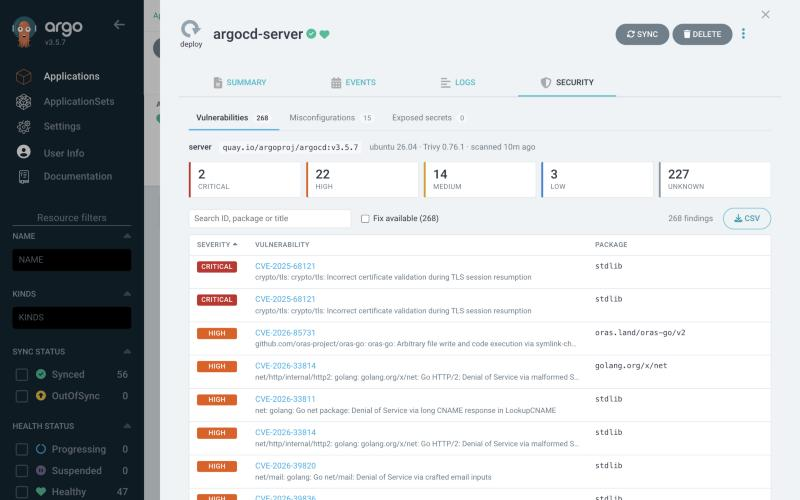
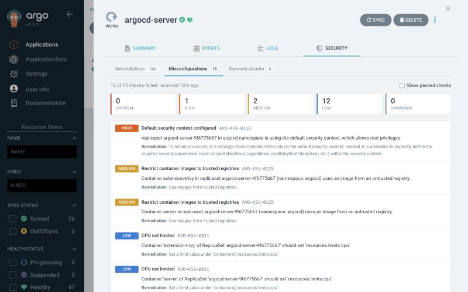
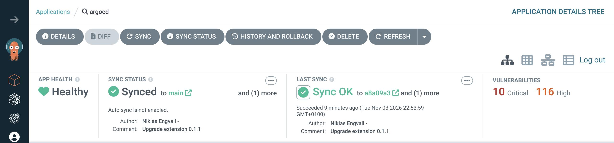
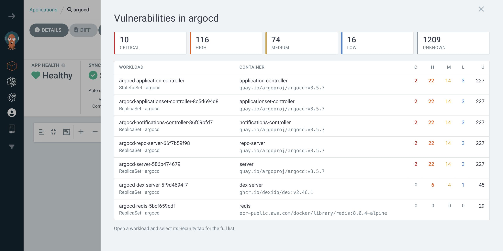

# Argo CD Trivy extension

[](https://github.com/trappiz/argocd-ui-trivy-extension/actions/workflows/ci.yaml)
[](https://github.com/trappiz/argocd-ui-trivy-extension/releases)
[](LICENSE)

An Argo CD UI extension that shows the security reports produced by
[trivy-operator](https://github.com/aquasecurity/trivy-operator) right next to
the workloads they belong to. Open a Deployment, StatefulSet or Pod in Argo CD
and you get a **Security** tab listing its image vulnerabilities, failed
configuration checks and exposed secrets.



## Features

- **Vulnerabilities.** Every CVE in every container image, with severity, CVSS score,
  installed and fixed versions, and a link to the advisory. You can filter by
  severity, search, show only findings that have a fix, sort, and export to CSV.
- **Misconfigurations.** Failed `ConfigAuditReport` checks with the exact message
  and the suggested remediation.
- **Exposed secrets.** Keys and credentials that Trivy found baked into
  images.
- **Application summary.** A status panel in the application header shows
  critical and high totals. Clicking it opens a per-workload breakdown.
- **No backend.** The extension reads reports through Argo CD's own API, so it
  respects your existing RBAC and works with every cluster Argo CD manages.

## Screenshots

**Misconfigurations.** Failed checks from `ConfigAuditReport`, with the
remediation trivy-operator suggests.



**Application summary.** Critical and high totals in the application status bar.



**Per-workload breakdown.** Clicking the totals opens a flyout listing every
scanned container in the application.



## Requirements

- Argo CD 2.10 or newer. The resource tab works from 2.6, and the status panel
  needs 2.10. Development targets Argo CD 3.5.
- trivy-operator running in every cluster whose workloads you want to see.
- `aquasecurity.github.io` resources must **not** be listed in Argo CD's
  `resource.exclusions`. The extension finds reports in the application's
  resource tree, so Argo CD has to track them.

## Installation

The extension is a single JavaScript file. Argo CD loads it from
`/tmp/extensions` inside the `argocd-server` container. The
[argocd-extension-installer](https://github.com/argoproj-labs/argocd-extension-installer)
runs as an init container that downloads the release, verifies the checksum
and puts the file in place.

Pick a version from the [releases page](https://github.com/trappiz/argocd-ui-trivy-extension/releases).
The examples below use `v0.1.3`.

### Helm

With the [argo-cd chart](https://artifacthub.io/packages/helm/argo/argo-cd):

```yaml
server:
  extensions:
    enabled: true
    extensionList:
      - name: extension-trivy
        env:
          - name: EXTENSION_URL
            value: https://github.com/trappiz/argocd-ui-trivy-extension/releases/download/v0.1.3/extension-trivy.tar
          - name: EXTENSION_CHECKSUM_URL
            value: https://github.com/trappiz/argocd-ui-trivy-extension/releases/download/v0.1.3/extension-trivy_checksums.txt
```

### Kustomize

Patch the `argocd-server` Deployment with an init container and a shared
volume. A complete example is in [`examples/kustomize`](examples/kustomize).

```yaml
apiVersion: apps/v1
kind: Deployment
metadata:
  name: argocd-server
spec:
  template:
    spec:
      initContainers:
        - name: extension-trivy
          image: quay.io/argoprojlabs/argocd-extension-installer:v1.1.0
          env:
            - name: EXTENSION_URL
              value: https://github.com/trappiz/argocd-ui-trivy-extension/releases/download/v0.1.3/extension-trivy.tar
            - name: EXTENSION_CHECKSUM_URL
              value: https://github.com/trappiz/argocd-ui-trivy-extension/releases/download/v0.1.3/extension-trivy_checksums.txt
          volumeMounts:
            - name: extensions
              mountPath: /tmp/extensions/
          securityContext:
            runAsUser: 1000
            allowPrivilegeEscalation: false
      containers:
        - name: argocd-server
          volumeMounts:
            - name: extensions
              mountPath: /tmp/extensions/
      volumes:
        - name: extensions
          emptyDir: {}
```

After `argocd-server` restarts, reload the UI. The **Security** tab appears
on supported resources, and **Vulnerabilities** appears in the application
status bar.

### Verifying a release

Each release includes a SHA-256 checksum, which the installer checks, and a
signed build provenance attestation:

```bash
gh attestation verify extension-trivy.tar --repo trappiz/argocd-ui-trivy-extension
```

## How it works

trivy-operator stores its findings as custom resources owned by the object it
scanned. A Deployment's images are scanned through its current ReplicaSet,
while CronJobs, StatefulSets and DaemonSets are scanned directly. Report names
are often hashed, so they can't be derived from the workload name.

So the extension doesn't guess names. It walks the application's resource tree
and follows owner references:

1. It collects reports owned by the selected resource or anything below it.
2. If that finds nothing, as with a Pod, it walks up the owner chain until it
   reaches an ancestor that has reports.
3. When a Deployment or Rollout has several ReplicaSets, it keeps only the
   newest one that has been scanned. Findings for images you no longer run
   are left out.

Each report is then fetched through `GET /api/v1/applications/{name}/resource`,
the same endpoint the Argo CD UI uses for its live manifest view.

## Permissions

The extension needs nothing beyond what the user already has. Anyone who can
open an application can read the reports inside it. Users who can't get
the application see an "Access denied" message instead of data.

## Development

You need Node.js 20 or newer (`.nvmrc` pins the version CI uses).

```bash
npm install
npm run dev        # preview with sample data at http://localhost:8000
npm test           # unit tests
npm run lint       # ESLint and Prettier
npm run format     # apply Prettier formatting
npm run typecheck
npm run package    # builds dist/extension-trivy.tar
```

The preview in `dev/` provides a stand-in for Argo CD's `extensionsAPI` and
answers API calls from fixtures, so you can work on the UI without a cluster.
Add `?dark` or `?flyout` to the URL to open it in those states.

To try a local build against a real Argo CD, copy
`dist/resources/extension-trivy/extension-trivy.js` into
`/tmp/extensions/` in the `argocd-server` container and reload the UI.

## Releasing

1. Move the entries under `## [Unreleased]` in [CHANGELOG.md](CHANGELOG.md) into a
   new version section and update the compare links at the bottom.
2. Bump the version: `npm version 0.2.0 --no-git-tag-version`.
3. Commit, then tag and push: `git tag v0.2.0 && git push origin main v0.2.0`.

The release workflow checks that the tag matches `package.json`, runs the
tests, builds the archive, and publishes a GitHub release using that version's
changelog section as the release notes. Tags with a suffix, such as
`v0.2.0-rc.1`, are published as pre-releases.

## License

[Apache License 2.0](LICENSE)
